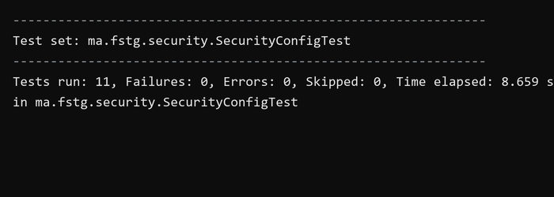
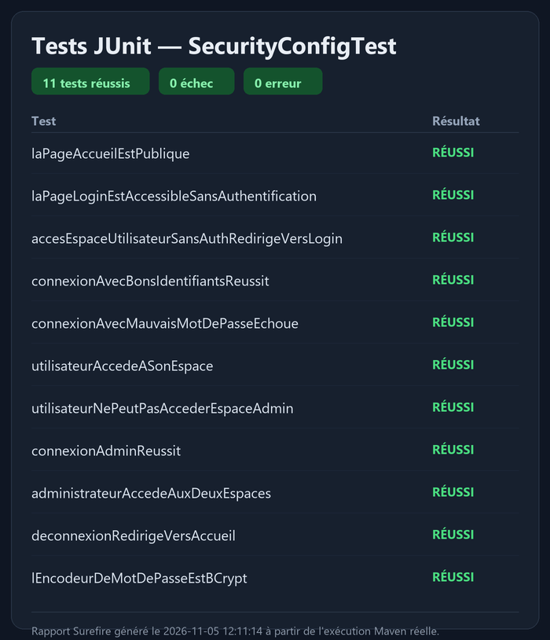
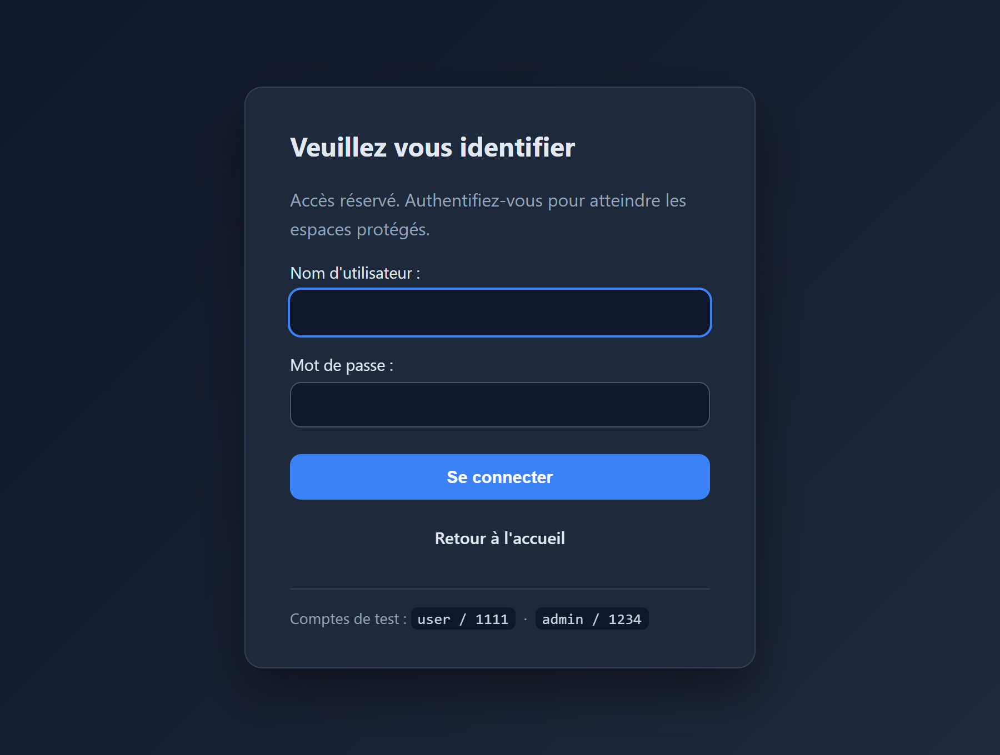
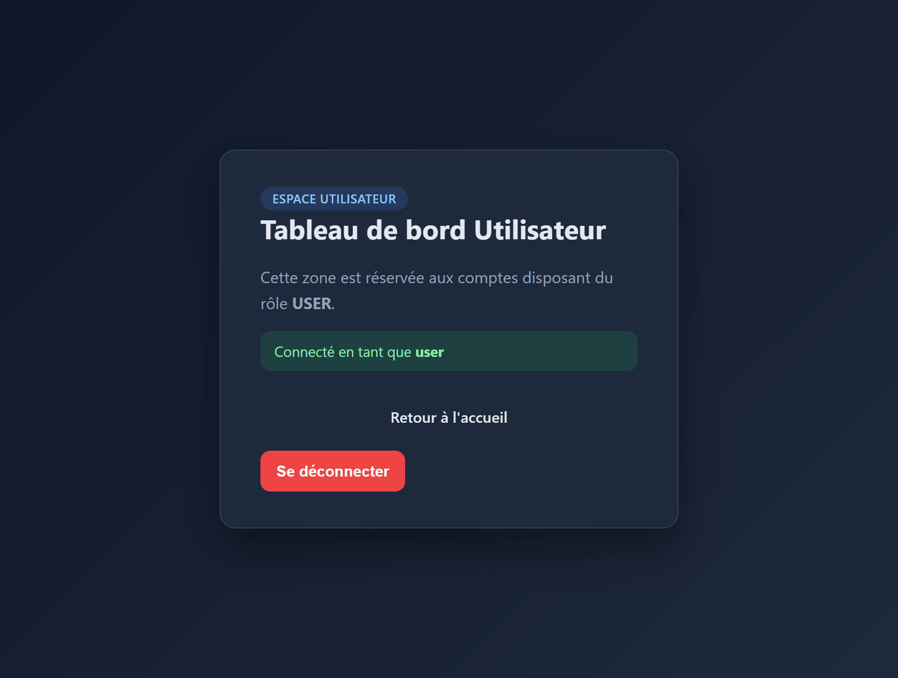
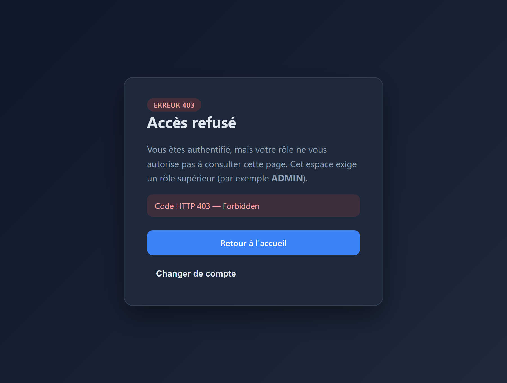
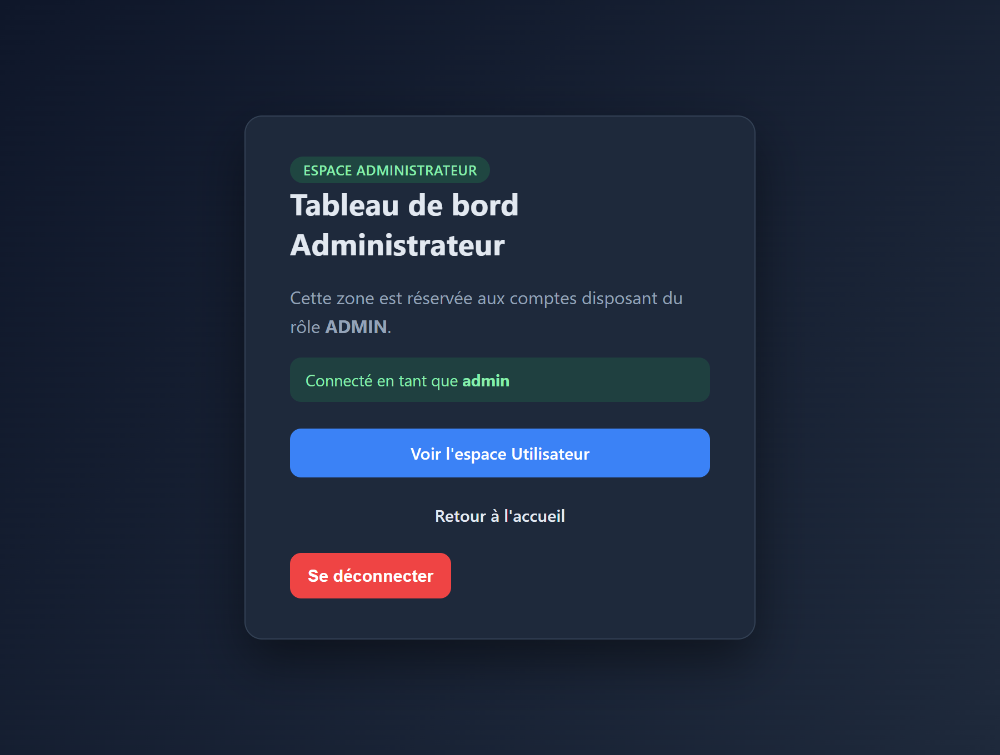

# TP9 — Authentification en mémoire avec Spring Security

J'ai réalisé une application web Spring Boot sécurisée par **Spring Security** avec une
authentification **en mémoire**. Deux comptes sont déclarés au démarrage via un
`InMemoryUserDetailsManager` : `user / 1111` (rôle `USER`) et `admin / 1234`
(rôles `ADMIN` + `USER`). Les mots de passe ne sont jamais stockés en clair : ils
sont hachés à la volée avec `BCryptPasswordEncoder`.

La sécurité est centralisée dans trois classes de configuration du package
`ma.fstg.security.config` :

- `SecurityConfig` définit le bean `SecurityFilterChain` : la page d'accueil (`/`) et
  les ressources CSS sont publiques, `/user/**` exige le rôle `USER`, `/admin/**`
  exige le rôle `ADMIN`, et toute autre requête nécessite une authentification
  (`anyRequest().authenticated()`). Le formulaire de connexion personnalisé, la
  déconnexion et leurs redirections y sont configurés.
- `UserDetailsConfig` déclare les utilisateurs et leurs rôles en mémoire.
- `PasswordEncoderConfig` expose le bean `PasswordEncoder` (BCrypt).

Le contrôleur `HomeController` (`ma.fstg.security.web`) expose les routes `/`,
`/login`, `/user/dashboard` et `/admin/dashboard`. Les vues sont des templates
**Thymeleaf** (`src/main/resources/templates`) avec une page de connexion
personnalisée et une page d'erreur `403` stylée. La protection **CSRF** est active :
les jetons sont injectés automatiquement dans les formulaires Thymeleaf.

J'utilise **Java 17** et **Maven** (Spring Boot 3.3.5). Pour lancer le projet :

```sh
mvn clean verify
mvn spring-boot:run
```

L'application démarre sur `http://localhost:8080/`.

## Comptes de test

| Utilisateur | Mot de passe | Rôles          | Accès                                   |
|-------------|--------------|----------------|-----------------------------------------|
| `user`      | `1111`       | `USER`         | `/` et `/user/dashboard`                |
| `admin`     | `1234`       | `ADMIN`, `USER`| `/`, `/user/dashboard`, `/admin/dashboard` |

## Règles d'accès vérifiées

- `/` est **public** (HTTP 200 sans authentification).
- L'accès à un espace protégé sans authentification **redirige vers `/login`** (HTTP 302).
- Le compte `user` accède à `/user/dashboard` (200) mais est **refusé** sur
  `/admin/dashboard` (**HTTP 403 – Accès refusé**).
- Le compte `admin` accède aux **deux** espaces (200).
- Un **mauvais mot de passe** renvoie vers `/login?error`.
- La **déconnexion** (`/logout`) renvoie vers `/` et reprotège les espaces.

## Captures d'écran

### Résultats des tests

Les captures ci-dessous proviennent de l'exécution réelle de `mvn clean verify` :
le résumé Surefire et le rapport JUnit indiquent **11 tests réussis**, sans échec ni
erreur. Les tests utilisent `MockMvc` et `spring-security-test` pour traverser la
vraie chaîne de filtres Spring Security (voir `SecurityConfigTest`).

**Résumé des tests Surefire**



**Rapport JUnit**



### Application en fonctionnement

Captures réelles de l'application lancée (`java -jar`), prises au navigateur
(Microsoft Edge) via Playwright.

**Page de connexion personnalisée**



**Espace Utilisateur (connecté en tant que `user`)**



**Accès refusé — `user` tente d'ouvrir l'espace Administrateur (HTTP 403)**



**Espace Administrateur (connecté en tant que `admin`)**



## Preuves d'exécution (`evidence/`)

- `test-output.txt` — journal complet de `mvn clean verify`.
- `surefire-summary.txt` — résumé Surefire (`Tests run: 11, Failures: 0, Errors: 0`).
- `junit/TEST-ma.fstg.security.SecurityConfigTest.xml` — rapport JUnit XML.
- `demo-output.txt` — vérification des scénarios de sécurité par requêtes HTTP réelles
  (200 public, 302 vers login, 403 pour `user` sur `/admin`, connexion/déconnexion).
- `live-server-output.txt` — journal du serveur embarqué Tomcat au démarrage.
